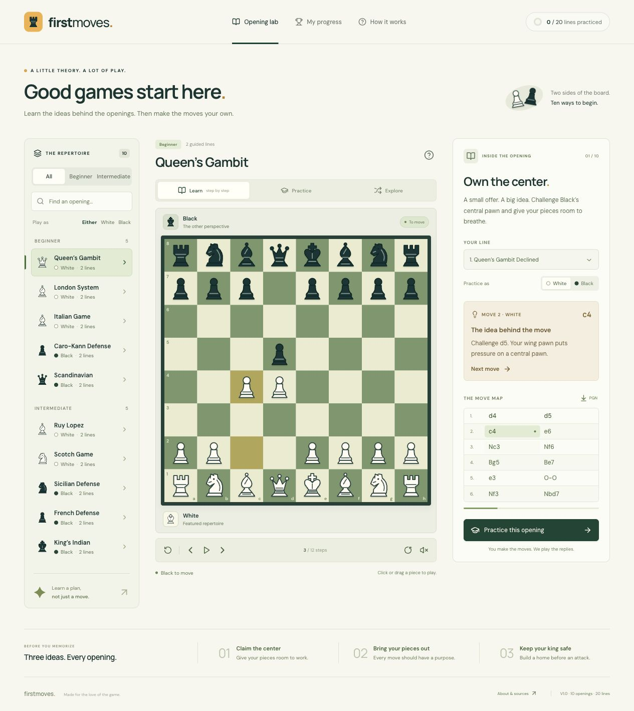

# First Moves — The opening lab

An interactive introduction to classic chess openings. Built for GitHub Pages with React, Vite, and chess.js. Everything runs in the browser; no backend, account, API key, or paid service is required.



## Version 1 curriculum

Each opening includes **two annotated teaching lines**, both playable as **White or Black**. There are 20 lines and 40 practice perspectives in total. Difficulty describes the depth of the lesson, not a required rating.

| Beginner             | Lines                                      |
| -------------------- | ------------------------------------------ |
| Queen’s Gambit       | Declined; Accepted                         |
| London System        | Classical setup; against an Indian setup   |
| Italian Game         | Giuoco Pianissimo; against the Two Knights |
| Caro-Kann Defense    | Advance; Exchange                          |
| Scandinavian Defense | Classical …Qa5; quiet …Qd8                 |

| Intermediate          | Lines                                                    |
| --------------------- | -------------------------------------------------------- |
| Ruy Lopez             | Morphy Defense; Exchange                                 |
| Scotch Game           | Classical; Schmidt                                       |
| Sicilian Defense      | Open Sicilian with a classical setup; against the Alapin |
| French Defense        | Advance; Exchange                                        |
| King’s Indian Defense | Classical setup; against the Fianchetto                  |

The lines cover six or seven full moves. These are starting points for learning plans, not exhaustive repertoires or forced sequences. An opponent can deviate. The app calls a legal off-line move “different” rather than claiming it is a mistake or providing an engine evaluation.

## Use the trainer

- **Learn:** Step through the moves and their explanations, click the move map to revisit a position, or autoplay. You can also play the expected move yourself.
- **Practice:** Start from the initial position, play your selected color, and receive automatic replies along the selected line. Future notation is hidden. Hints show the move and an arrow. Completing a line saves progress for that color.
- **Explore:** Continue from the position on screen, control both colors, and try any legal moves. There is no computer opponent in this mode. Take back moves or restart to try again.
- Click a piece and its destination, or drag it. Castling moves the king two squares; promotion presents four choices. The rules library enforces check, castling rights, en passant, checkmate, and draws.
- Flip the board, optionally enable move sounds, or download the full lesson/current exploration as a PGN file.
- Filter the opening library by lesson level or featured repertoire color. The color filter describes the suggested repertoire; every lesson still supports both colors.
- Open **About this opening** for both sides’ plans and a common pitfall. **How it works** includes keyboard instructions.
- Progress is stored only in this browser, under `first-moves-progress-v1`. It does not sync across devices. Reset it from **My progress → Reset saved progress**.
- Share a lesson using its URL hash, for example `#london/classical`. Hash links also work under a GitHub project subpath.

## Run locally

Use Node.js **22.12+** (or 24+) and npm.

```sh
npm ci
npm run dev
```

Open the local URL printed in the terminal. For a production preview:

```sh
npm test
npm run build
npm run preview
```

`npm run build` produces `dist/`. Serve that folder over HTTP; do not open `index.html` as a `file://` URL. Fonts and chess pieces are bundled locally, so the application makes no runtime API or font-service requests. External reference links are optional.

## Deploy on GitHub Pages

The included [deployment workflow](.github/workflows/deploy.yml) runs the tests and build on pull requests and deploys successful pushes to `main`. Vite uses relative asset paths, so the same build works at `https://OWNER.github.io/REPOSITORY/`, at an account site root, or on a custom domain.

1. Create an empty GitHub repository (a public repository works with GitHub Free). Add these project files to it; keep `package-lock.json`, but exclude `node_modules/` and `dist/`.
2. Push the source to the `main` branch.
3. In the repository, select **Settings → Pages → Build and deployment → Source → GitHub Actions**.
4. Open **Actions → Test and deploy to GitHub Pages → Run workflow**, or push a new change to `main`.
5. After the deployment succeeds, use the site URL shown under the `github-pages` deployment or in **Settings → Pages**.

If initializing this local folder yourself, replace the example remote with your repository URL:

```sh
git init -b main
git add .
git commit -m "Build First Moves opening trainer"
git remote add origin https://github.com/OWNER/REPOSITORY.git
git push -u origin main
```

If your repository already contains files, integrate this project into that checkout rather than overwriting its history. If your default branch differs from `main`, update the branch filters and deployment condition in the workflow.

The workflow uses GitHub’s built-in token. No deployment secret or personal access token belongs in the source. A custom domain is optional; configure it in Pages settings after the first deployment.

### This repository

- Repository: [anoopdesai7/first-moves](https://github.com/anoopdesai7/first-moves)
- App: [First Moves](https://anoopdesai7.github.io/first-moves/)
- Publishing source: GitHub Actions, using `.github/workflows/deploy.yml`.
- Successful pushes to `main` publish automatically after the curriculum tests and production build pass.

The repository is public so GitHub Pages can host it on GitHub Free. For deployment status, open the repository’s Actions tab.

GitHub’s official instructions: [custom Pages workflows](https://docs.github.com/en/pages/getting-started-with-github-pages/using-custom-workflows-with-github-pages) and [configuring a publishing source](https://docs.github.com/en/pages/getting-started-with-github-pages/configuring-a-publishing-source-for-your-github-pages-site).

## Validation

```sh
npm test
npm run build
```

The automated tests cover the 5+5 curriculum, every move and annotation, both practice perspectives for all 20 lines, correct/illegal/alternative move handling, castling, en passant, all promotion types, game-ending statuses, malformed/blocked progress storage, and PGN round-trips.

Manual browser checks cover guided practice from both colors, automatic replies, legal off-line feedback, hints, castling, progress after reload, exploration, filters, lesson switching, and responsive layouts. GitHub deployment itself must be verified after connecting a repository.

## Editing the curriculum

- `src/openings.js`: Opening metadata, plans for both sides, references, and the two lines with move-by-move teaching notes. Each note corresponds to exactly one move token. Use legal standard algebraic notation (SAN).
- `src/trainer.js`: Pure chess/progress helpers.
- `src/App.jsx`: Lesson, practice, exploration, progress, and navigation flows.
- `src/components/Board.jsx`: Accessible board controls and hint arrows.
- `src/components/Piece.jsx`: Original local SVG chess pieces.
- `src/styles.css`: Responsive visual design.
- `tests/trainer.test.js`: Curriculum and rules validation.

To add a line, give it a stable ID, SAN move list, and one note for every move. Keep IDs stable so existing progress and shared links remain valid. Run the tests before publishing a curriculum change.

## Sources and credits

Teaching notes and vector pieces are original to this project. Opening families and central ideas were checked against the individual [Chess.com opening references](https://www.chess.com/openings), also linked inside every lesson. The selected lines are illustrative teaching sequences and are not represented as engine-best analysis.

- [chess.js](https://github.com/jhlywa/chess.js) — BSD-2-Clause
- [React](https://react.dev/) — MIT
- [Lucide icons](https://lucide.dev/license) — ISC
- DM Sans and Manrope via [Fontsource](https://fontsource.org/) — SIL Open Font License

Bundled third-party license texts are included at `public/third-party-licenses.txt`, which is copied into the deployed site.
